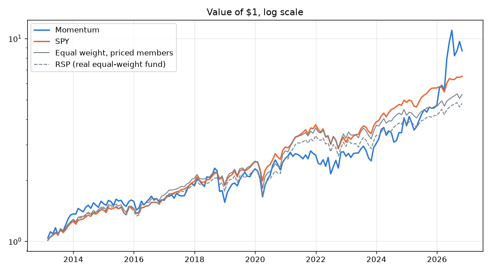

# Shadow Portfolio

Log the stocks you've bought and see whether you beat the S&P 500. Every dollar you put
into a stock is also spent on SPY on the same day, in a "shadow portfolio". Same money,
same dates, two outcomes.

No build step and no dependencies: plain HTML, CSS and ES modules.

## Run it

ES modules need to be served over HTTP, so opening `index.html` by double-click won't work.

```bash
python3 -m http.server 5173
```

Then open http://localhost:5173. The tests are at http://localhost:5173/tests/.

## Layout

| File | What it does |
|---|---|
| `index.html` | Page markup |
| `css/styles.css` | Theme tokens (light and dark) and all styles |
| `src/market.js` | Seeded price simulation, trading-day calendar, ticker list |
| `src/portfolio.js` | The day-by-day walk that values your portfolio and the SPY shadow |
| `src/chart.js` | SVG line chart with hover and keyboard navigation |
| `src/store.js` | localStorage persistence and the example trades |
| `src/format.js` | Money, percent and date formatting |
| `src/app.js` | Wires the table, stat tiles and chart together |
| `tests/` | Browser-run checks for the simulation and the math |
| `scripts/compare.py` | Your real trades vs the same money in SPY, on real prices |
| `scripts/momentum.py` | Monthly momentum backtest on real S&P 500 members |

## How the math works

`compute()` in `src/portfolio.js` walks forward one trading day at a time. Each day it
applies any trades dated that day, then values every holding at that day's close. When a
trade spends $X on a stock, the shadow portfolio buys $X of SPY at that same day's SPY price.

## Things to know

- **Prices are simulated.** `src/market.js` generates a seeded random walk from Jan 2, 2020
  to today, so prices are the same on every reload but are not real market data. To use
  real prices, replace `createMarket()` with something that returns the same shape.
- **Buys only.** There is no way to log a sale.
- **Weekends roll forward** to the next trading day. Market holidays are not skipped.
- **Trades are saved in the browser** (localStorage), per device.
- **Add a ticker** by adding a line to `TICKERS` in `src/market.js`.

## Compare your own trades against the index

`scripts/compare.py` answers one question with real prices: did the stocks I bought beat
putting that same money into the S&P 500 on the same days?

Every dollar spent on a stock is also spent on SPY that day, in a shadow portfolio. Same
money, same dates, so the comparison can't cheat on timing — it never assumes you invested
a lump sum at a convenient moment.

```bash
python3 -m venv .venv
.venv/bin/pip install yfinance pandas matplotlib
.venv/bin/python scripts/compare.py --selftest   # checks the math, no network
.venv/bin/python scripts/compare.py              # reads data/trades.csv
```

Make `data/trades.csv` from `data/trades.example.csv`:

```
date,ticker,dollars
2025-01-15,AAPL,500
```

Date bought, ticker, dollars spent. The script works out the shares from that day's close.
It prints what you invested, what your picks are worth, what the index would have returned,
the gap, a per-stock breakdown, and writes a chart to `results/`.

Your own `data/trades.csv` is gitignored, so positions stay off GitHub.

### Two things in there worth knowing

**Shape handling.** yfinance returns a different structure for one ticker than for several —
a MultiIndex on the columns — so `fetch_closes()` flattens both cases to one plain frame
instead of letting that difference leak into the rest of the code.

**Weekends.** A trade dated on a Saturday is filled at the next trading day's close rather
than dropped or erroring, which is what would really have happened to the order.

### What the comparison can and can't tell you

It measures a result, not a skill. A handful of positions over a year or two is far too
small a sample to separate good picking from a sector that happened to run, and an index
fund logged as a trade is being compared against itself. Read the gap as what happened,
not as evidence it will happen again.

## Momentum backtest

`scripts/momentum.py` tests a stock-picking rule on real prices from Yahoo Finance. Each month it
takes the stocks that were in the S&P 500 on that date, buys the 10 with the biggest gain from
12 months ago to 1 month ago, holds them for a month, and compares the result with the same money
in SPY. It charges 0.1% on every dollar traded.

```bash
python3 -m venv .venv
.venv/bin/pip install yfinance pandas matplotlib
.venv/bin/python scripts/momentum.py                    # S&P 500 members as of each date
.venv/bin/python scripts/momentum.py --universe fixed   # 45 of today's big companies (biased)
.venv/bin/python scripts/momentum.py --end 2022-12-31   # tuning period only
.venv/bin/python scripts/momentum.py --refresh          # re-download membership and prices
```

The first run downloads about 800 tickers and caches them in `data/prices_cache.pkl`. Charts go
to `results/`. Index membership comes from [fja05680/sp500](https://github.com/fja05680/sp500).

**Leftover bias.** Yahoo drops stocks once they are delisted, so about 180 former members have no
prices and can't be picked. The script measures what that costs: an equal-weight portfolio of
every member it has prices for is compared with RSP, a real equal-weight S&P 500 fund that held
every member. The gap (about +0.8% a year) is the bias still left. Removing it fully needs paid
data that includes delisted stocks, such as Norgate or EODData.

This is a learning tool, not investment advice.


